# Bank Management System (C++17)

A console-based banking application written in modern C++ using OOP (inheritance, encapsulation), exceptions, and file storage.

## Screenshots

### Create account & login
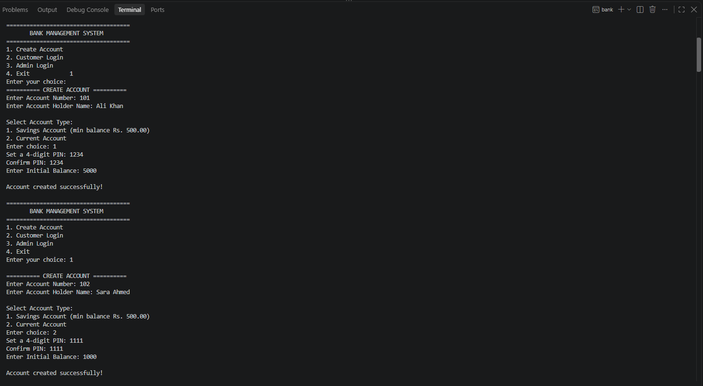
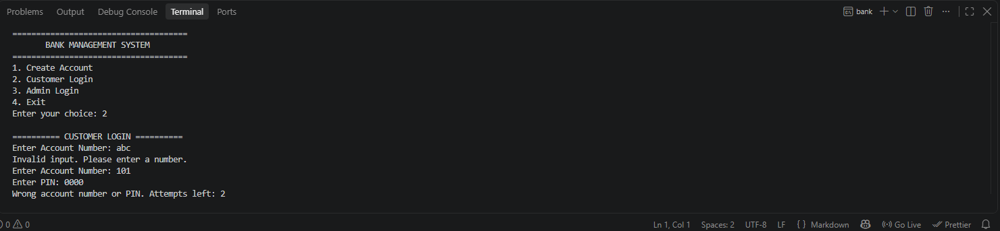
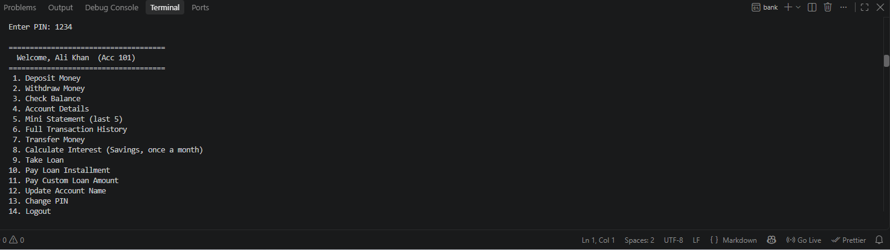

### Transactions & rules
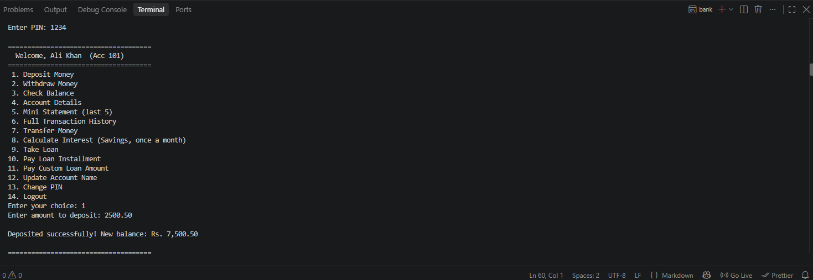
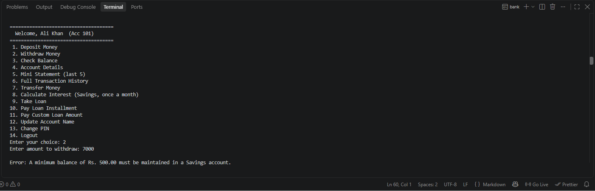
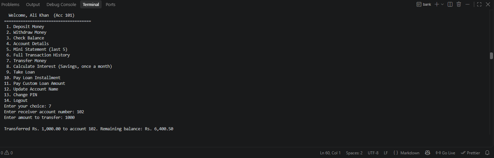
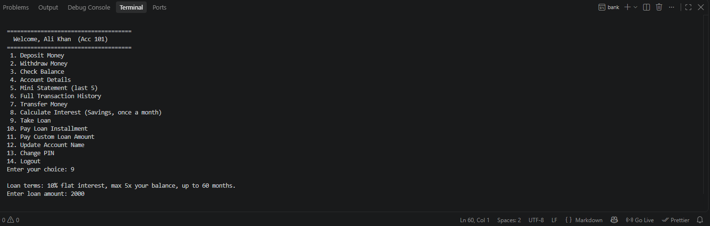
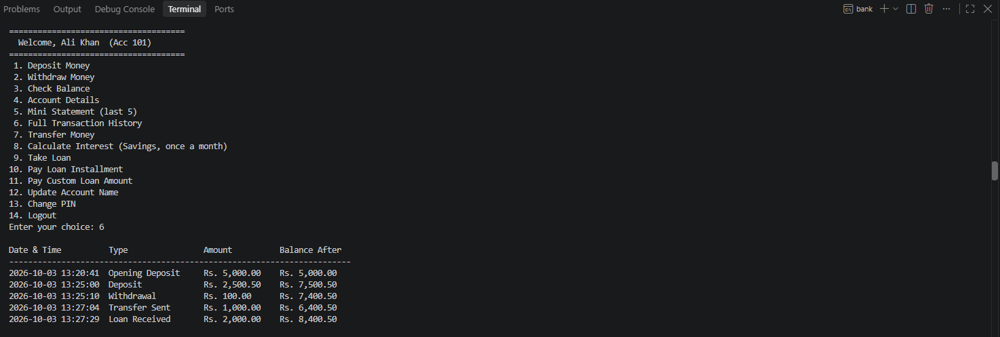
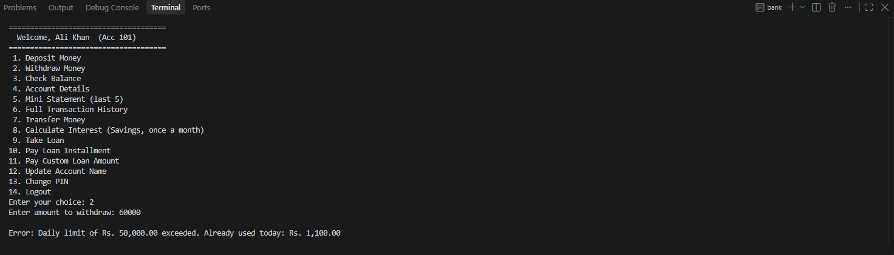

### Admin panel
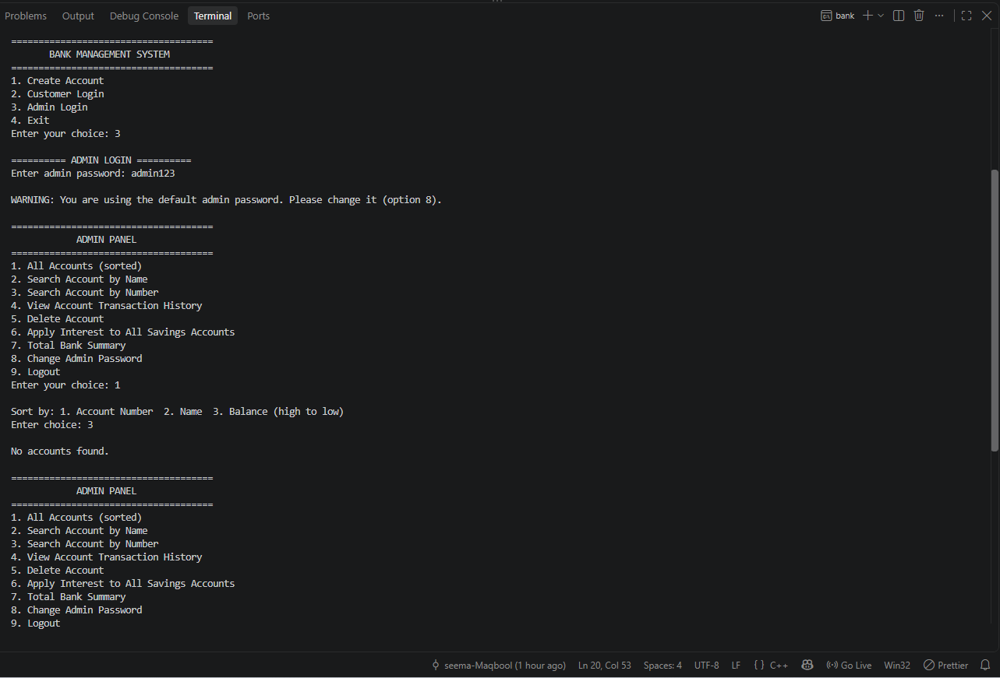
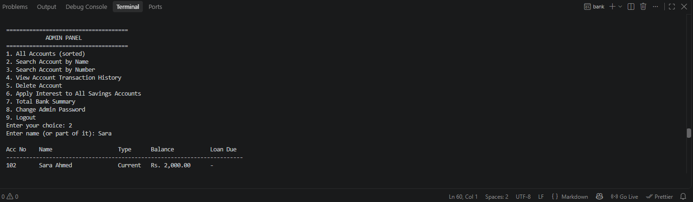
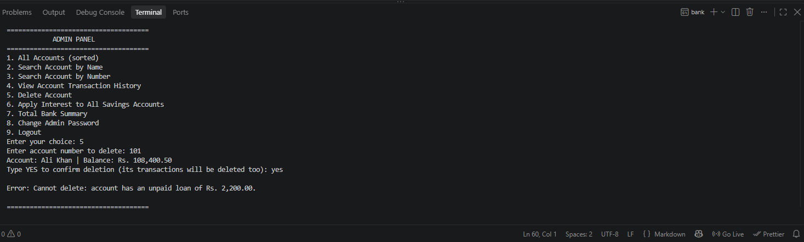

### Data saved & tests
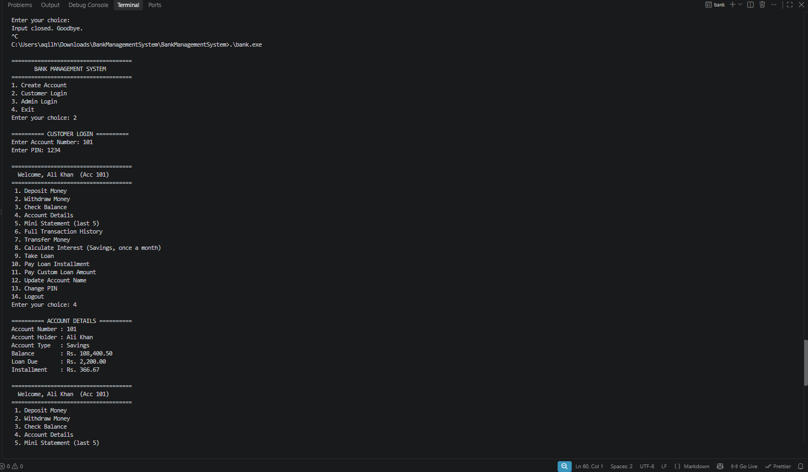
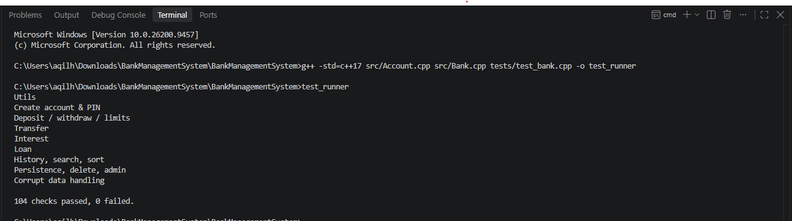

## Features

**Customer**
- Create Savings / Current accounts, login with a **4-digit PIN** (stored as salted SHA-256 hash, never plain text)
- Deposit, withdraw, check balance, account details
- **Transfer money** between accounts
- **Mini statement** (last 5) and full **transaction history with date & time**
- **Monthly interest** for Savings accounts (applied once per month, automatically at startup or manually)
- **Loan module**: take a loan, pay installments or custom amounts
- Update account name, change PIN

**Admin** (default password `admin123` - change it on first login)
- View all accounts sorted by number / name / balance
- Search by name (partial, case-insensitive) or by number
- View any account's history, delete accounts, apply interest to all, bank summary, change admin password

**Rules enforced**
- Savings: minimum balance Rs. 500, daily limit Rs. 50,000
- Current: daily limit Rs. 200,000
- Loan: max 5x balance, 10% flat interest, up to 60 months, one active loan at a time
- Accounts with an unpaid loan cannot be deleted

**Engineering**
- Money stored as integer paisa (no floating-point errors)
- Input via `getline` everywhere (no `cin` buffer bugs); 3 login attempts
- `BankError` exceptions for all rule violations
- Safe file saving (write to temp file, then rename); corrupt records are skipped, not crashed on
- 100+ automated unit checks

## Project structure
```
src/
  Utils.h      money, SHA-256, input helpers
  Account.h/.cpp   Account base class, SavingsAccount, CurrentAccount
  Bank.h/.cpp      accounts, transactions, admin, file storage
  main.cpp         menus
tests/test_bank.cpp   unit tests
screenshots/          images used in this README
Makefile
```

## Build & run
```bash
make          # builds ./bank
./bank

make test     # builds and runs the unit tests
```
Without make: `g++ -std=c++17 src/Account.cpp src/Bank.cpp src/main.cpp -o bank`

Data is saved in the `data/` folder (git-ignored).

## Future improvements
- SQLite database instead of text files
- Hidden PIN entry, account lockout that persists across restarts
- GUI or REST API front end
